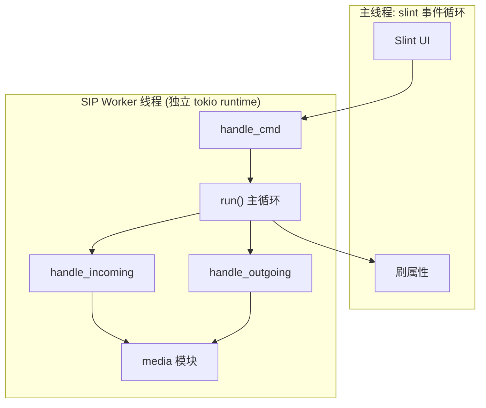
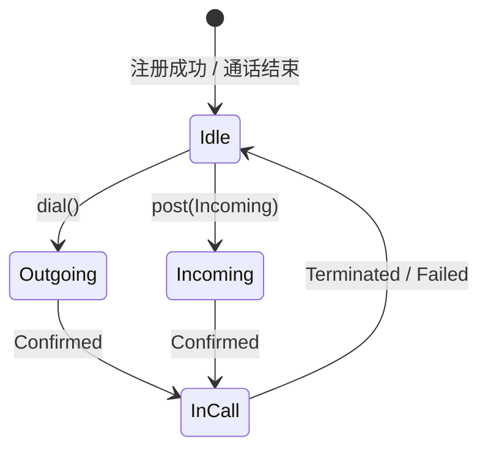
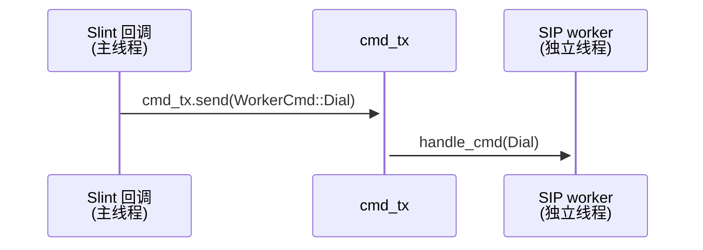
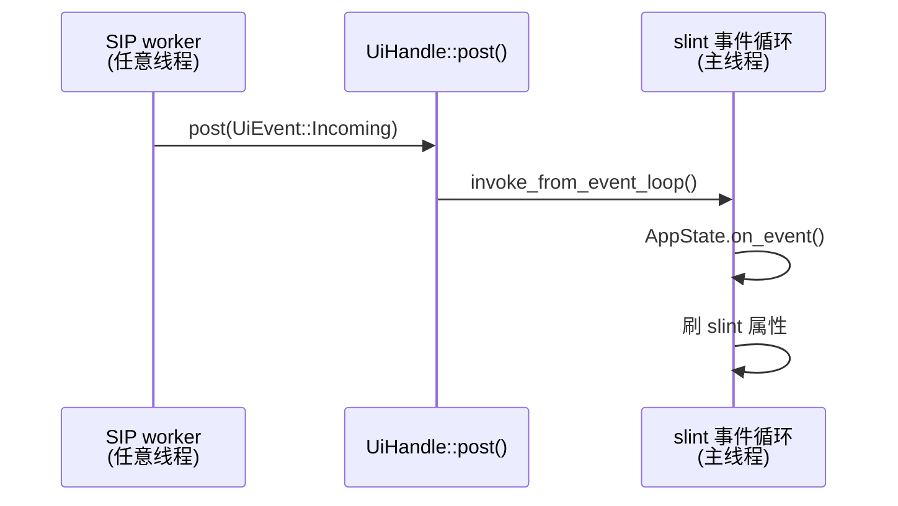
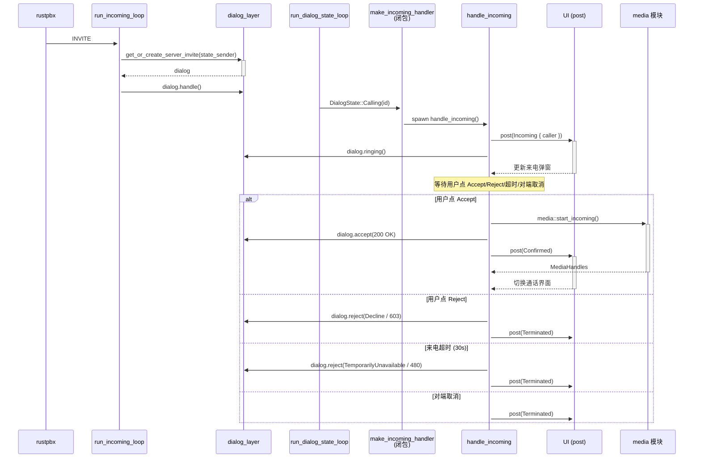
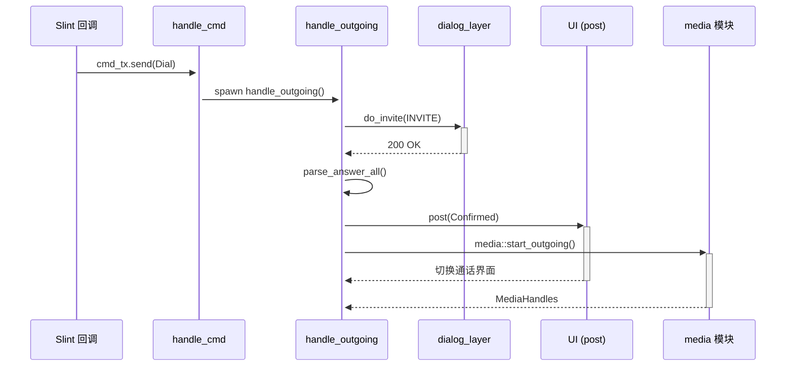
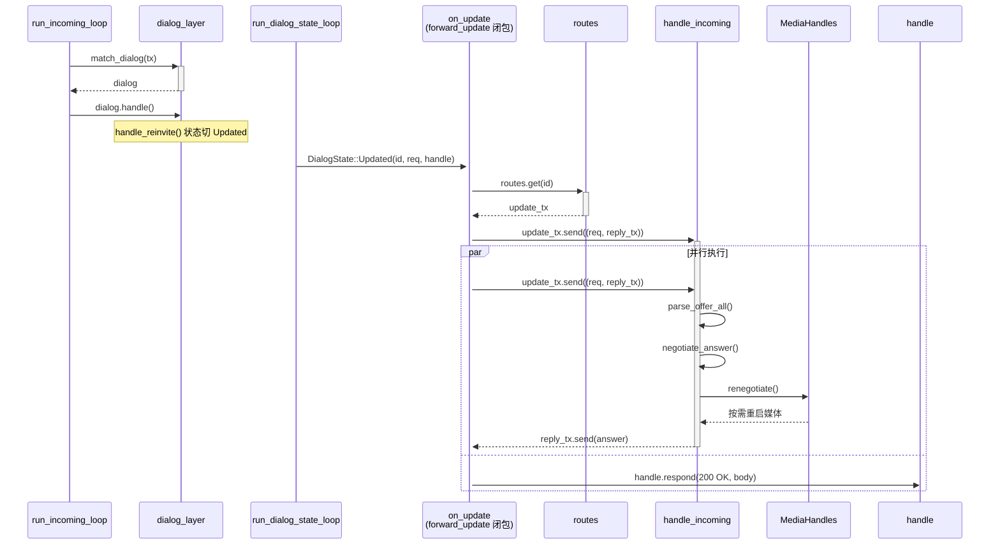
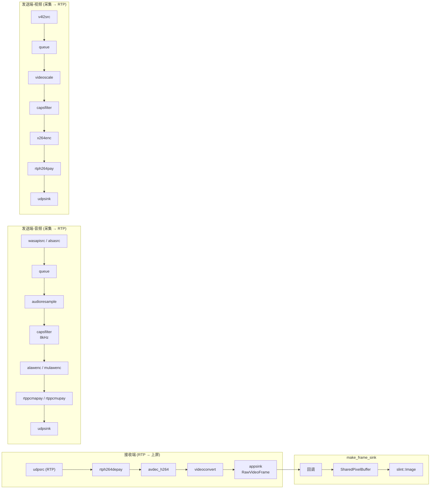
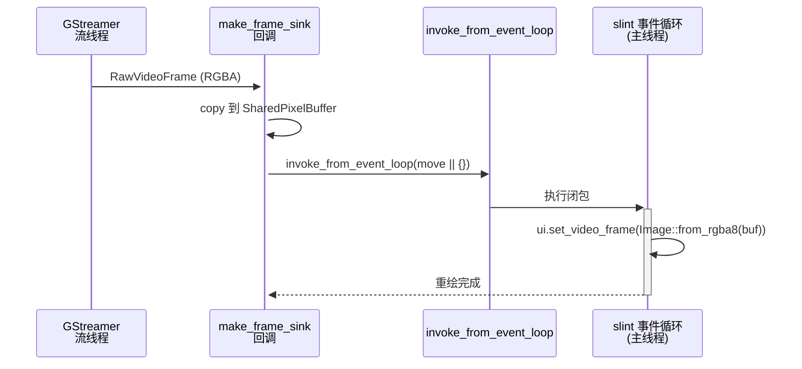
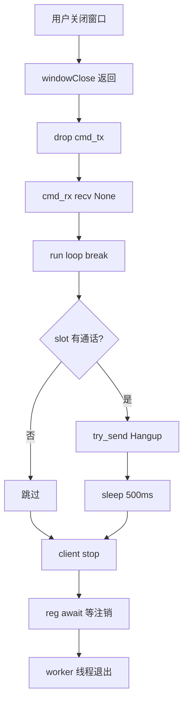

# call-ui 模块详细机制

## 1. 线程模型

- **Slint UI** 在**主线程**跑事件循环，被 `#[tokio::main]` 阻塞
- **SIP worker** 在**独立线程**跑自己的 tokio runtime，不绑主线程
- 两边通过 `UiHandle::post`（worker→UI）和 `cmd_tx.send`（UI→worker）通信

---

## 2. 状态机

- `Idle`：初始状态，注册成功或通话结束后在此
- `Outgoing`：主叫拨号等待对方接听
- `Incoming`：被叫收到来电，等待用户操作
- `InCall`：通话中

---

## 3. 通道设计

### 3.1 UI → worker（tokio unbounded channel）

- unbounded channel：Slint 回调是同步上下文，不能阻塞等消息

### 3.2 worker → UI（slint event loop）

- `post()` 把事件塞进 slint 事件循环，保证线程安全
- `slint::invoke_from_event_loop` 让任意线程可以操作 UI 状态

---

## 4. 被叫来电流程

---

## 5. 主叫拨号流程

---

## 6. re-INVITE 处理

- 对端发 re-INVITE（To 带 tag，in-dialog 请求）
- `run_dialog_state_loop` 通过 `routes` 表找到对应通话任务的 `update_tx`
- 通话任务内解析 SDP + 重新协商 + 按需重启媒体
- oneshot 回复通道把 answer SDP 带回 `on_update`

---

## 7. 媒体面架构

- **接收**：`udpsrc` → depay → 解码 → `appsink` → `make_frame_sink` → slint 纹理
- **发送-音频**：`wasapisrc`（麦克风）→ 编码 → `rtppcmapay` → `udpsink`
- **发送-视频**：`v4l2src`（摄像头）→ videoscale → x264enc → `rtph264pay` → `udpsink`
- `MediaHandles` 按指纹（编码/地址/pt）比对决定是否重启管线

---

## 8. 视频上屏流程

- GStreamer **流线程**执行 `make_frame_sink` 回调
- `slint::Image` 不是 Send，不能跨线程移动
- 先 copy 到 `SharedPixelBuffer`（纯像素数据，可以 Send）
- 在 slint 事件循环里包成 `Image` 设置到 UI

---

## 9. 窗口关闭流程

---

## 10. 关键设计决策

| 决策 | 原因 |
|------|------|
| 独立线程 + tokio runtime | Slint 事件循环占住主线程，SIP 事务需要异步 IO，在独立线程跑自己的 runtime 避免冲突 |
| Slot 占线模型 | 同时只有一路通话，新来电时如果 slot 被占用直接回 486 BusyHere，简化状态管理 |
| `Arc<Mutex<AppState>>` | Slint UI 和 worker 都需要读写 AppState，用 Arc<Mutex> 而非 Rc<RefCell> 是因为 worker 线程需要 Send |
| `UiHandle` 用 Weak | 避免循环引用导致内存泄漏，post() 失败时 warn 而不是 panic |
| 媒体单路不崩原则 | 接收器或发送器启动失败只 warn，对应路 None，通话不因一路媒体挂掉 |
| `IncomingCtx` 参数打包 | 消除 8 参数列表的 `#[allow(clippy::too_many_arguments)]`,`slot`/`routes` 只在收尾用,保留独立传参 |
