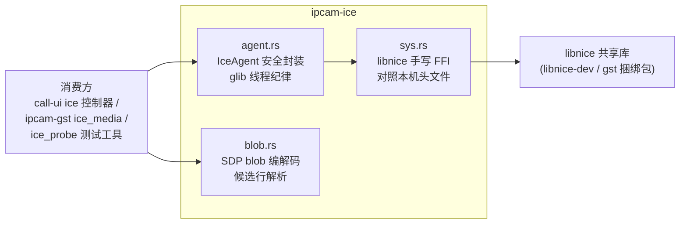
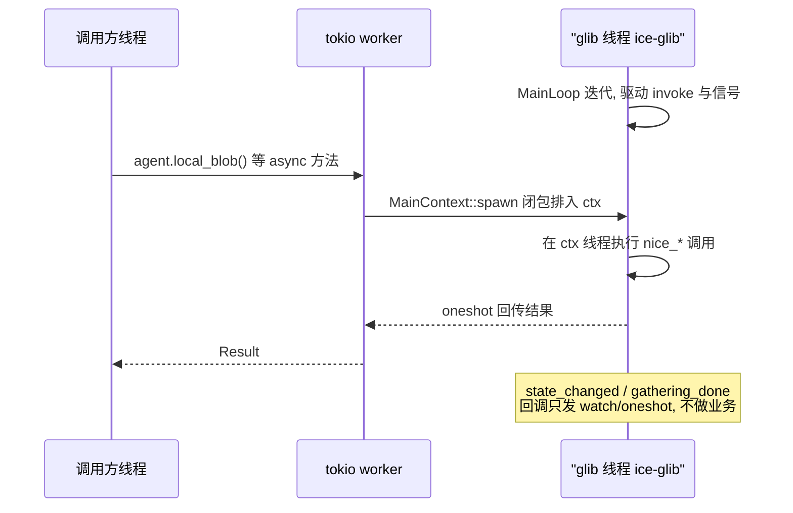

# ipcam-ice

libnice ICE agent 的安全封装: 控制面 (gather/交换/连通/状态) + 数据面
(component 收发), **独立于 gstreamer 媒体栈** — 正式依赖只有
glib/gio/tokio/tracing, 无桌面环境也能编译运行, 供 UI 与无头测试工具复用。

## 概述

一句话: 把 libnice 的 NiceAgent 包成线程安全的 Rust 句柄, 对外只暴露
`IceAgent` 一个类型 + SDP 文本 blob 的编解码, P2P 打洞细节全部藏在
一条自建 glib 线程里。

边界:

- **不管媒体**: 音视频管线 (nicesink/nicesrc) 在 `ipcam-gst` 的
  `ice_media.rs`, 它通过 [`IceAgent::raw_agent`](src/agent.rs:444) 拿裸指针
  注入元件属性 — 所以本 crate 不需要 gstreamer
- **不管信令传输**: blob 怎么搬运 (WS 中继 / 复制粘贴) 是消费方的协议,
  本 crate 只生产/消费 blob 文本
- **不做 trickle ICE**: gather 完成一次性出全量 blob (非 trickle),
  与手动搬运场景兼容

## 核心机制

### 分层结构



- `sys.rs` 是手写 FFI (不跑 bindgen), 逐条对照本机 `nice/agent.h` /
  `nice/candidate.h` 核实; `#[link(name = "nice")]` 链接 (src/sys.rs:50),
  Linux 走默认搜索路径, Windows 由 build.rs 用 pkg-config 问出 gst 捆绑包的
  nice.lib 目录 (build.rs)
- `agent.rs` 是唯一的安全封装层, 所有 unsafe 都收在这一个文件里
- `blob.rs` 纯文本处理, 零 unsafe; `sdp.rs` 同样纯文本 (标准媒体 SDP 与
  ICE 属性互转), 供 sigserver/SIP 两条信令路径复用

### 线程模型 (本模块最重要的一条纪律)

NiceAgent 必须活在它被创建的 GMainContext 线程上. 本 crate 的做法:
`IceAgent::new` 起一条独立 glib 线程 (`ice-glib`), 自建 MainContext 跑
MainLoop; **一切 `nice_*` 调用经 `invoke` marshal 回该线程执行**, 调用方
线程绝不直接碰裸指针; GObject 信号回调同样在该线程触发, trampoline 内
只做无锁 channel 发送, 不做业务 (src/agent.rs:1-10 模块注释,
invoke 实现 src/agent.rs:453 附近).



状态订阅因此是免轮询的: `IceState` 变化经 watch channel 推给
`state_rx()` 的订阅者 (src/agent.rs:399), 晚订阅也能读到当前值.

### 生命周期与 GObject 引用账

- `new()`: `nice_agent_new` 初始引用 + `from_glib_none` 显式强引用 =
  两份引用; 建流 component 数按 `IceConfig.components` (media 约定 1=video,
  2=audio, 纯数据场景传 1, src/agent.rs:142 注释), 初始化上限 5s (src/agent.rs:157)
- `close()`: 消费 self, 先经 `ctx.invoke` 在 glib 线程归还第一份引用,
  **quit 必须在同一个 invoke 闭包内** (quit 在闭包外会被 MainLoop 边界
  检查跳过, unref 丢失 — src/agent.rs:282 的顺序论证), join 线程后
  第二份随 gobj Drop 归还
- 调用方纪律: close 前必须停掉所有 nicesink/nicesrc 类使用者
  (媒体先停, agent 后关, 否则元件活在已 finalize 的 NiceAgent 上)

### 信令 blob 原理

blob 就是 libnice 原生 SDP 文本: `local_blob()` 触发候选收集, 等
gathering-done (上限 10s) 后 `nice_agent_generate_local_sdp` 一次性导出
(src/agent.rs:326); 对端 blob 经 `add_remote()` 喂入
`nice_agent_parse_remote_sdp` (src/agent.rs:383), 连通性检查随即开始.
`blob.rs` 额外提供 `a=candidate:` 行解析供状态展示 (src/blob.rs:32),
注意展示用的 `CandKind` 只有 Host/Srflx/Relay 三种 (SDP 里不出现 prflx),
查询真实选中路径要用下面的 `SelectedKind`.

### 选中路径查询

`selected_pair(component)` (src/agent.rs:407) 走
`nice_agent_get_selected_pair` FFI (src/sys.rs:87), 读 `NiceCandidate`
首字段 `type` 得出 (本地, 远端) 候选类型. 布局依据是本机
`nice/candidate.h`: `type` 是结构体第一成员, 枚举值
HOST=0/SRFLX=1/PRFLX=2/RELAYED=3 (src/sys.rs:25-31); 未连通或值越界
返回 None, 不会误读.

### Windows 补丁

本机 libnice (gst 捆绑 0.1.23) 枚举本机地址走 getnameinfo 但自身不调
WSAStartup, 裸用会导致 gather 立即失败; `ensure_winsock` 用
`g_networking_init` 幂等补齐 (src/agent.rs:29, cfg windows).

## 公共 API 速览

| 项 | 位置 | 说明 |
|---|---|---|
| `IceAgent::new(IceConfig)` | src/agent.rs:157 | 建 agent + glib 线程; `IceConfig{stun, controlling, components}` |
| `local_blob()` | src/agent.rs:326 | gather 完成, 返回本地 blob (超时报错) |
| `local_blob_within(limit)` | src/agent.rs | 有上限 gather; 超时用已收集候选 |
| `add_remote(&IceBlob)` | src/agent.rs:383 | 喂对端 blob, 触发打洞 |
| `state_rx()` | src/agent.rs:399 | watch 订阅 IceState 变化 |
| `wait_connected(timeout)` | src/agent.rs:405 | 等 Connected; Failed/超时返回 IceError |
| `selected_pair(u32)` | src/agent.rs:407 | 选中路径 (本地, 远端) 候选类型 |
| `send(&[u8])` | src/agent.rs:472 | 数据面发送, 固定 component 1 |
| `attach_recv(f)` | src/agent.rs:496 | 数据面接收回调, 固定 component 1 |
| `raw_agent()` | src/agent.rs:444 | 裸指针, 仅供 ice_media 注入元件属性 |
| `close()` | src/agent.rs:282 | 关停 (先停媒体再关, 见生命周期节) |
| `IceBlob` | src/blob.rs:11 | SDP 文本薄包装, `from_sdp`/`as_str`/`candidates` |
| `sdp::append_ice` | src/sdp.rs | 把本端 ICE 注入标准 SIP offer/answer |
| `sdp::parse_offer` | src/sdp.rs | 从标准媒体 SDP 提取 video/audio ICE (可选路) |
| `sdp::media_endpoint` | src/sdp.rs | 指定网卡上的 UDP host 候选端点 (m= 端口) |

## 数据面使用注意 (attach_recv 的泄漏纪律)

`attach_recv` 每次调用会把回调通道 Box **和一个接收 std::thread 一起
泄漏到进程退出** (blocking_recv 循环只随进程退出结束). 这是既有纪律升格
为 pub  API 时的显式约定 (src/agent.rs:496 文档注释): 一次性测试工具/
单测场景无感知, **长驻进程请勿反复调用** — 长驻媒体收发请走
ipcam-gst 的 nicesink/nicesrc 通路, 不经此 API.

## ice_probe: 无头连通性测试工具

`examples/ice_probe.rs` — 两台机器各跑一个实例验证真实跨网打洞:

```text
cargo run -p ipcam-ice --example ice_probe --features signal -- --sig ws://HOST:9000 [--room NAME] [--stun stun://...] [--timeout SECS]
```

流程: 连 sigserver join 房间 → 按槽位定角色 (slot 0 = offerer) → 交换
blob → 等 Connected → 双向各发一帧 payload 断言互通 → 打印
`ICE OK local=<类型> remote=<类型>`. 退出码: 0 = 连通, 1 = 失败, 2 =
参数错误 (clap 解析). WS 依赖只在 dev-dependencies, 不污染正式依赖.

## 构建要求

- Linux: `libnice-dev` (链接 + 头文件不在本 crate 使用范围 — FFI 已手写,
  但链接需要库本身)
- Windows: GStreamer MSVC 捆绑包在 PATH/PKG_CONFIG_PATH (build.rs 用
  pkg-config 定位 nice.lib)
- 运行期媒体场景另需 gst 的 gstnice 插件 (gstreamer1.0-nice), 纯
  agent/数据面测试不需要

## 与其他模块的关系

- `crates/call-ui/src/ice/`: UI 控制器, 消费本 crate 的 agent + blob,
  信令走 `ipcam_ice::signal` + sigserver
- `crates/ipcam-gst/src/ice_media.rs`: 媒体管线, 经 `raw_agent()` 注入
  nicesink/nicesrc 的 agent 属性
- `crates/media_talk_rust/src/bin/sigserver.rs`: WS 房间中继, ice_probe
  与 call-ui 的信令对端 (协议镜像 Frame 结构)

## 关键文件表

| 文件 | 作用 |
|---|---|
| src/sys.rs | 手写 libnice FFI + 信号 trampoline + 候选类型常量 |
| src/agent.rs | IceAgent 安全封装: glib 线程纪律 / 引用账 / 状态订阅 / 数据面 |
| src/blob.rs | SDP blob 包装与候选行解析 (展示用) |
| src/sdp.rs | 标准媒体 SDP 与 ICE 属性互转 (sigserver / SIP 共用) |
| src/signal.rs | sigserver WS 客户端: join / 槽位 / blob 交换 (feature=signal) |
| src/lib.rs | 模块组织与 re-export |
| build.rs | Windows 下 nice.lib 链接搜索 |
| examples/ice_probe.rs | 双机连通性测试工具 |

## 已知取舍 (记录不修)

- 重建给 libnice 的 ICE-only SDP 必须用 `\n` 分行: `nice_agent_parse_remote_sdp`
  只按 `\n` 切分且不 trim, CRLF 会让候选行末 token 变成 `host\r`, 整份被拒
- `nice_agent_set_remote_credentials` 已封装但暂无调用点 (blob SDP 路径
  不经过它), 保留供后续直喂 credentials 的场景 (src/sys.rs:5-7 注释)
- 呼叫期对端 hangup 的 WS 转发不读 (协议保留, 消费方各自取舍)
- **本版 libnice 的收包路径依赖 attach_recv 路由**: 不挂回调时 socket I/O
  落到进程默认 ctx (无人迭代), 表现为 "STUN 无回包 / srflx 必缺 / 连通性
  检查无响应". `IceAgent::new` 已为每个 component 自动挂路由空回调, 正常
  使用无需关心; 仅当绕过 `IceAgent` 直接用裸 NiceAgent 时才需要自行处理
  (2026-11-12 实测定位, 曾误判为 Windows 进程级不确定性)
