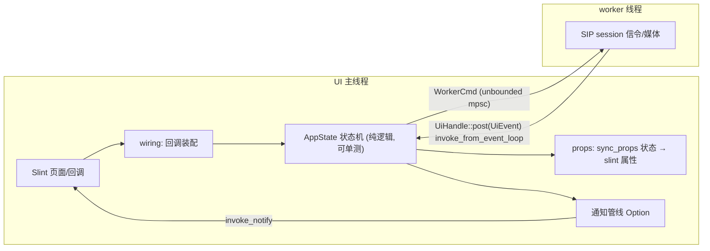

# call-ui 通信框架

通话 GUI 的 UI ↔ 后台通信设计：Slint 界面在主线程，SIP 信令与媒体在后台
worker 线程，中间靠四条单向通道连接。核心纪律：**状态机在中间，两边都
不许越界** —— worker 不拼文案、不碰 UI 对象，UI 不做业务判断。

## 总览



## 四条通道

### 1. 命令：UI → worker（`WorkerCmd`，unbounded mpsc）

`Dial(String) / Hangup / Accept / Reject`。用 **unbounded** 是有意的：
slint 回调是同步上下文，不能阻塞等 channel 容量；命令量极小，无背压
需求。UI 回调不直接发命令，先过状态机（`AppState::dial/accept/...`）
决策出 `Option<WorkerCmd>`，无效操作（通话中再拨号）在状态机里就被
拦下，根本不到 worker。

### 2. 事件：worker → UI（`UiHandle::post(UiEvent)`）

worker 任何线程可调 `post`：内部 `slint::invoke_from_event_loop` 排队
回主线程，先过状态机 `on_event`，再 `sync_props` 把状态字段刷到 slint
属性。跨线程靠 `Weak<MainWindow>`（窗口销毁后升级失败即丢弃）+
`Arc<parking_lot::Mutex<AppState>>`（锁只在 invoke 闭包里短暂持有）。

`UiEvent` 只描述**发生了什么**（Registered / Incoming / Confirmed /
Terminated / Failed / Notify），不带展示逻辑。事件可能迟到（挂断后才
来 Confirmed），状态机负责按当前 phase 丢弃不匹配的迁移——这是界面
不乱跳的唯一防线。

### 3. 通知管线：后端 → UI 的提示/警告（`Notice`）

通话生命周期事件之外的消息（错误条、toast）统一走这里：

```rust
pub struct Notice {
    pub level: NoticeLevel,  // Info/Warn → toast; Error → 顶部错误条
    pub kind: NoticeKind,    // Raw/RegisterFailed/CallFailed: 结构化种类
    pub detail: String,      // 协议文本 (SIP 状态行等), 原样附加不翻译
}
```

关键设计：**`on_event` 返回 `Option<Notice>`，通知的唯一发源点在状态机**。
bridge 拿到什么就 `invoke_notify` 什么，不做任何判断和拼接。这样
"迟到的 Failed 不弹错误条"这类守卫是状态机里可单测的规则，而不是
散落在桥接层的特判（曾经的 bug：bridge 特判绕过状态机守卫，迟到的
失败照样弹条）。

slint 侧 `notify(level, kind, detail)` 回调按 kind 用 `@tr` 组文案
（i18n），按 level 选 toast 气泡（队列逐条展示，Timer 自动消化）或
顶部错误条（计时自动消失）。**后端永远不发文案** —— 新增一种通知只要：
`NoticeKind` 加一个枚举值 → `notice-msg()` 加一行 `@tr` → po 文件补
两条翻译。状态机、bridge 都不用碰。

与通话无关的纯提示（如"端口被占已回退"）由 worker 直接
`post(UiEvent::Notify(n))`，状态机原样透传。

### 4. 视频帧：接收管线 → UI（`VideoFrameSink` tap）

收端管线解码后经 tap 回调吐 RGBA 帧，`video::make_frame_sink` 把它
转成 slint `Image` 刷到 `video-frame` 属性上屏（取代 autovideosink，
画面嵌在通话页里）。接收器重启（re-INVITE 改编码）时 tap 是 Arc，
clone 复用不断流。

## 分层纪律

| 层 | 能做什么 | 不能做什么 |
|---|---|---|
| slint 页面 | 展示、收集点击、纯 UI 状态（当前子页/toast 队列） | 业务判断、直接读写 worker |
| wiring | UI 回调 → 状态机决策 → WorkerCmd | 改状态机内部字段 |
| AppState | 全部切换决策、通知裁决、通话记账 | 依赖 slint、做 IO |
| bridge | 线程摆渡（post/invoke） | 拼文案、事件特判 |
| worker/session | SIP 信令、媒体管线 | 碰 UI 对象、决定怎么展示 |

持久化也遵守"状态机不碰 IO"：通话记账先推进 `unsaved` 内存队列，
由 1s 定时器批量落 SQLite，关窗时补写（`persist.rs`）。

## 相关文件

- `crates/call-ui/src/app.rs` — 状态机 + `Notice`/`UiEvent` 定义
- `crates/call-ui/src/bridge.rs` — 命令通道工厂 + `UiHandle`
- `crates/call-ui/src/wiring.rs` — UI 回调装配
- `crates/call-ui/src/props.rs` — 状态 → slint 属性同步
- `crates/call-ui/src/session/` — SIP worker（worker/incoming/outgoing/call_loop）
- `crates/call-ui/ui/main.slint` — `notify` 回调、toast 队列、错误条
